I'm an SDET and the only QA on a live edtech app. Across 8 production releases on web and mobile I logged 150+ defects with steps to reproduce, and wrote 250+ test cases for a single release. I built a three-tier Playwright release gate against production, and a content tool that throws out its own draft if the AI writes a number I didn't give it. Write-ups of the work: [syedkm.com/work](https://syedkm.com/work)

This profile is held to the same rule. The script that builds it refuses to render a number I did not supply.

The last line is enforced. The build fails if a number here is not in my fact file.

## Selected work

Read the cases as text

**[Three-tier release gate for a live SaaS app](https://syedkm.com/work/release-gate-suite)**  
Context: Deep tests create real accounts in production on every run.  
Decision: Split the Playwright suite by what one run costs.  
Result: 9 critical, safe any time; 14 daily, on a schedule; 9 deep, on demand.

**[A content tool with a facts assertion](https://syedkm.com/work/facts-assertion)**  
Context: An LLM drafts posts only from facts I enter.  
Decision: A number I did not supply throws the draft away.  
Result: 3 tries, then the run fails; 500+ tests, automated.

**[Local QA and security harness](https://syedkm.com/work/local-security-harness)**  
Context: Functional tests never ask who else can read an account.  
Decision: Probe access, sessions and injection on localhost only.  
Result: fail-closed localhost gate; seeded data cleaned up; logs never hold real values; findings stay private.

**Scam-message checks in three languages**  
Context: Suspicious messages in English, Hindi and Kannada.  
Decision: A Python MCP server checks each against an India scam taxonomy.  
Result: 3 languages, English · Hindi · Kannada.

> Write-ups of the work: [syedkm.com/work](https://syedkm.com/work)

[syedkm.com](https://syedkm.com) · [LinkedIn](https://linkedin.com/in/s-yed) · [Instagram](https://instagram.com/_syedkhajamoinuddin)
